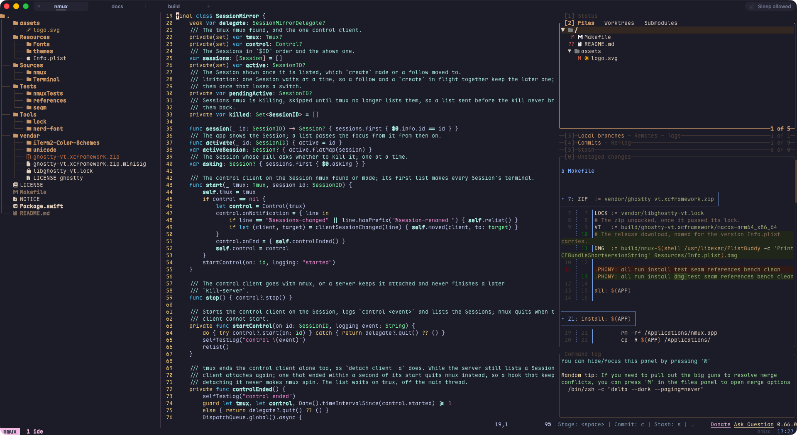
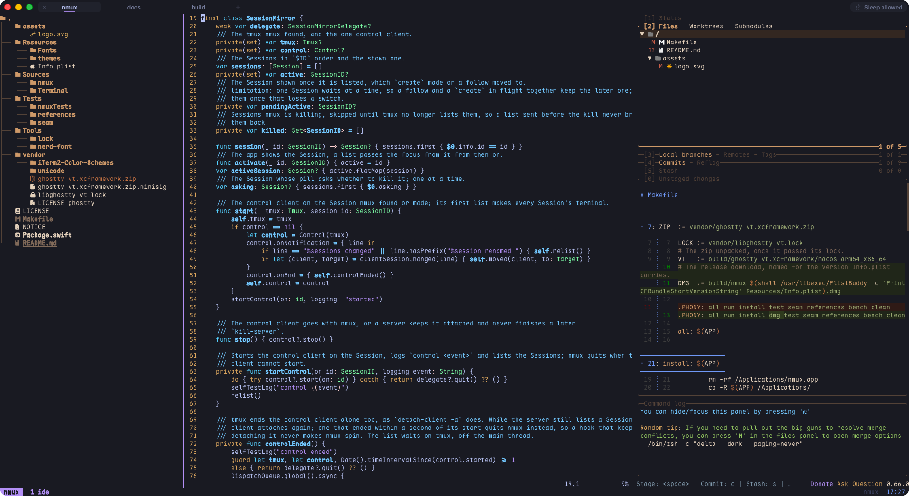
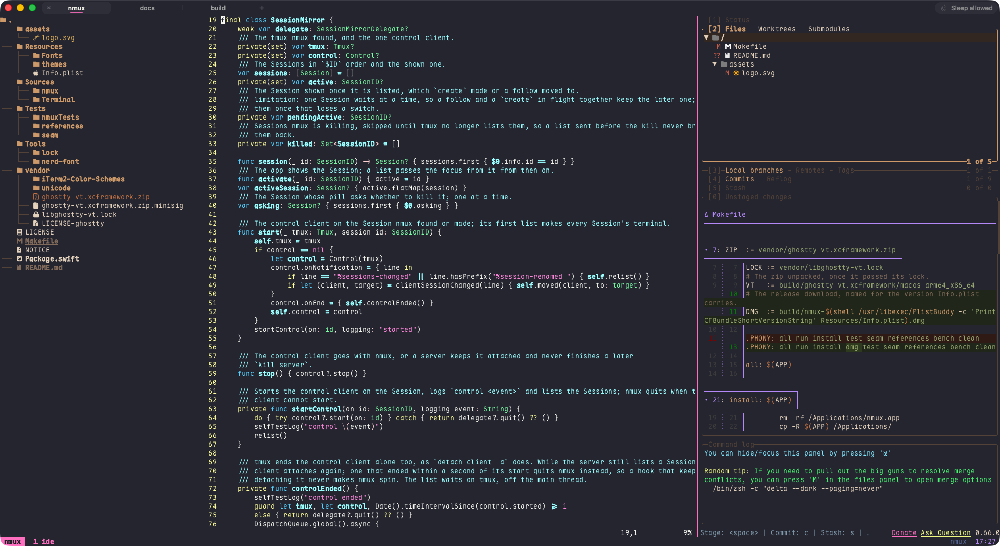
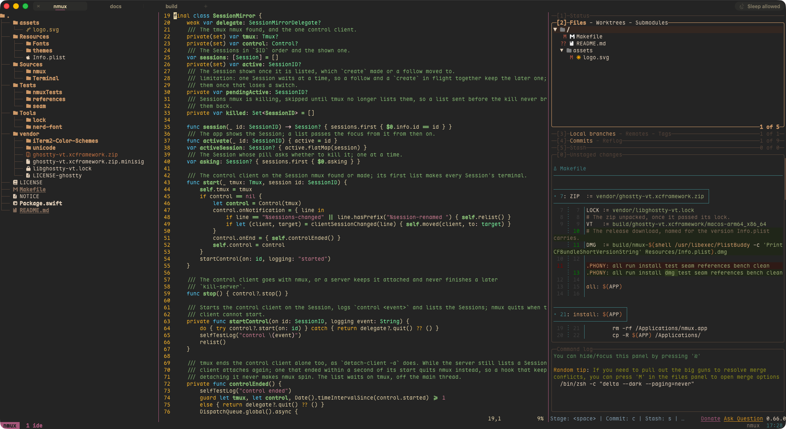

<p align="center"></p>

# nmux

nmux is a minimalist macOS terminal that shows every tmux Session as a pill at the top of its window.
It draws on the GPU through a Metal 4 renderer and parses the terminal with libghostty-vt.

## Why

When I work in a terminal, I work in tmux or a similar multiplexer. I also like the mouse and the
shortcuts every Mac app shares. In every terminal I used, I opened one tmux Session per tab by hand.
nmux is built around that habit.

I wanted a beautiful terminal. Ghostty gets close with enough configuration, but then I carry a
whole app for one view of tmux. The new tools for agentic development call themselves minimal, yet
they bring workspaces, sidebars and features I never use.

I also wanted to see and switch the Mac's own sleep control. macOS already ships `caffeinate`, so a
separate keep-awake app adds nothing the system lacks. The Keep-awake cup in the Session bar takes
the same power assertion as `caffeinate -i` and shows at a glance whether it is on.

nmux is deliberately primitive. It starts tmux and shows its Sessions. Your `.tmux.conf` decides the
rest: panes, padding, the status line and the colours inside tmux.

## Install

nmux needs macOS 26 on Apple silicon and tmux 3.4 or newer. Download the DMG from the latest
release:

```
https://github.com/pawelkolanowski/nmux/releases/latest
```

nmux is not notarized, so macOS blocks its first launch. You allow it once:

1. Open the DMG and drag nmux to Applications.
2. Open nmux. macOS says it cannot verify the app. Click Done.
3. Open System Settings, then Privacy & Security.
4. Scroll to Security, find the line about nmux, and click Open Anyway.
5. Confirm with your password or Touch ID.

From then on, nmux opens like any other app.

To build from source instead, see Build below.

## Config

nmux reads its Config from this file:

```
~/.config/nmux/config
```

When `XDG_CONFIG_HOME` is set, nmux reads this file instead:

```
$XDG_CONFIG_HOME/nmux/config
```

Without the file, every key takes its default. Cmd+, opens the file in your text editor. Cmd+Shift+,
reads it again without a restart.

The Config uses Ghostty's syntax: one `key = value` per line, with `#` comments. The last line of a
key wins. nmux skips a line it cannot use and lists it on a card with its number and the reason.
This Config sets a light and dark pair, Maple Mono and a translucent window:

```
theme = light:Fuwafuwa Sakura,dark:Catppuccin Mocha
font-family = Maple Mono
font-size = 15
background-opacity = 0.9
background-blur = true
```

| Key | Values | Default |
| --- | --- | --- |
| `theme` | a name, an absolute path, or `light:<name>,dark:<name>` | `Fuwafuwa Sakura` |
| `font-family` | a family name | SF Mono |
| `font-size` | a number above 0 | `14` |
| `font-thicken` | `true`, `false` | `false` |
| `option-as-alt` | `true`, `false`, `left`, `right` | `false` |
| `pill-width` | a number from 60 to 400, in points | `136` |
| `background-opacity` | a number, clamped to 0 to 1 | `1` |
| `background-blur` | `true` (a radius of 20), `false`, or a radius from 0 to 100 | `false` |
| `copy-on-select` | `true`, `false` | `false` |
| `clipboard-write` | `allow`, `deny`, `ask` | `allow` |
| `clipboard-read` | `allow`, `deny`, `ask` | `ask` |

A family that CoreText cannot find falls back to SF Mono.

A Theme is a file in Ghostty's theme format, and nmux reads only its colours. nmux looks a name up
in this folder first:

```
~/.config/nmux/themes/
```

Then nmux looks among the Themes in the app. A Theme found nowhere gives the Fallback look, which is
Terminal.app's Basic colours.

## Screenshots

One tmux window on this repository, laid out as an IDE: a file tree, Swift in vim, and lazygit. The
Session bar at the top shows three Sessions. The same setup appears in four Themes:

| Catppuccin Mocha | TokyoNight |
| --- | --- |
|  |  |

| Dracula | Gruvbox Dark |
| --- | --- |
|  |  |

## Features

- Every Session on the default tmux server is a pill in the Session bar. A Session created, renamed
  or killed anywhere changes the pills at once.
- nmux draws every frame on the GPU, with a Metal 4 renderer adapted from Ghostty's.
- libghostty-vt parses the terminal, so programs see the terminal Ghostty gives them.
- Box drawing, block elements and Powerline shapes are drawn to fit the cell. Symbols Nerd Font and
  Maple Mono ship inside the app.
- 861 Ghostty themes from iTerm2-Color-Schemes ship with nmux. A light and dark pair follows the
  Mac's appearance.
- The Config has eleven keys, in the syntax Ghostty uses.
- Cmd+T, Cmd+W, Cmd+1 to Cmd+9, Cmd+C and Cmd+V work as in any Mac app. Option types ą and ł,
  unless the Config makes it Alt.
- Clicks, drags and the scroll wheel go to tmux. A drag with Shift selects text, and Cmd+click opens
  a link.
- Closing a pill kills its Session, and nmux asks on the pill first. Closing nmux leaves the
  Sessions running unless you tick "Kill all Sessions".
- The Keep-awake cup at the right end of the Session bar keeps the Mac awake, as `caffeinate -i`
  does.
- A bell in a hidden Session puts the Bell mark, a dot, on its pill. nmux plays no sound.

## Build

The build needs these:

- macOS 26 on Apple silicon.
- Xcode and its command line tools.
- tmux 3.4 or newer.

The Makefile is the only build entry. A build downloads nothing, because libghostty-vt sits
committed under `vendor/`.

| Command | What it does |
| --- | --- |
| `make` | Builds `build/nmux.app`. |
| `make run` | Builds the app and opens it. |
| `make install` | Replaces `/Applications/nmux.app` with a fresh build. Quit nmux first. |
| `make dmg` | Builds `build/nmux-<version>.dmg` for a release. |
| `make test` | Runs the logic tests, then starts the app against a private tmux server. |
| `make clean` | Removes `build/` and SwiftPM's `.build/`. |

`make dmg` packs the app into the DMG a release offers.

nmux carries no certificate signature, only the ad hoc signature the linker gives every app on
Apple silicon.

## Architecture

tmux holds the state. Sessions outlive nmux, survive a crash and stay reachable over SSH. Panes,
windows and layouts belong to tmux, so nmux has none of its own.

nmux talks to tmux through one control client, which reports every Session created, renamed or
killed. Each pill has a terminal behind it that runs `tmux attach-session` for its Session. At launch nmux
turns on tmux's `mouse` and `set-clipboard` options and changes nothing else.

The code is two Swift modules:

- `Terminal` holds the pty, the VT host around libghostty-vt, key and mouse input, the clipboard,
  the glyph sprites and the Metal 4 renderer. It knows nothing of menus, windows or the app bundle.
- `nmux` is the app: the window, the Session bar, the tmux control client, the Config and the
  cards.

libghostty-vt is a pinned binary under `vendor/`, which every build checks against the SHA-256 in its lock file.
The renderer and the sprites are adapted from Ghostty, and nmux tunes them itself.

## Status

nmux does everything I need, so I don't plan new features. If you like it and use it, I'm glad. Bug
reports are welcome, but please don't expect a roadmap.

These stay out of scope:

- Linux and Windows.
- Splits, panes and layouts inside the app. tmux owns them.
- tmux options beyond `mouse` and `set-clipboard`.
- A settings window.
- Signing, notarization, auto-update and a Homebrew cask.
- VoiceOver.

## Licence

nmux is MIT. See `LICENSE`.

The software nmux bundles keeps its own licences. `NOTICE` lists them, and the app carries every
licence text.

- libghostty-vt and the code adapted from Ghostty: MIT.
- The Ghostty themes of iTerm2-Color-Schemes: MIT.
- Symbols Nerd Font: MIT.
- Maple Mono: SIL Open Font License 1.1.
